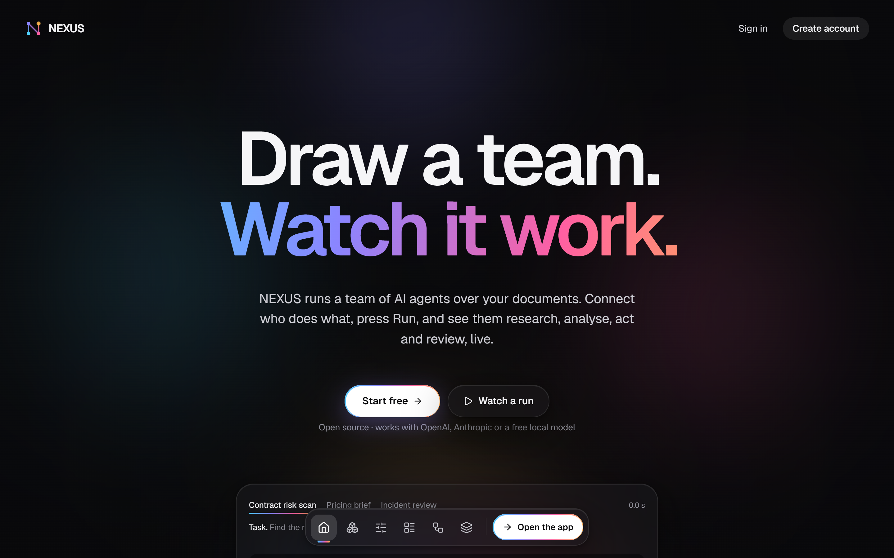
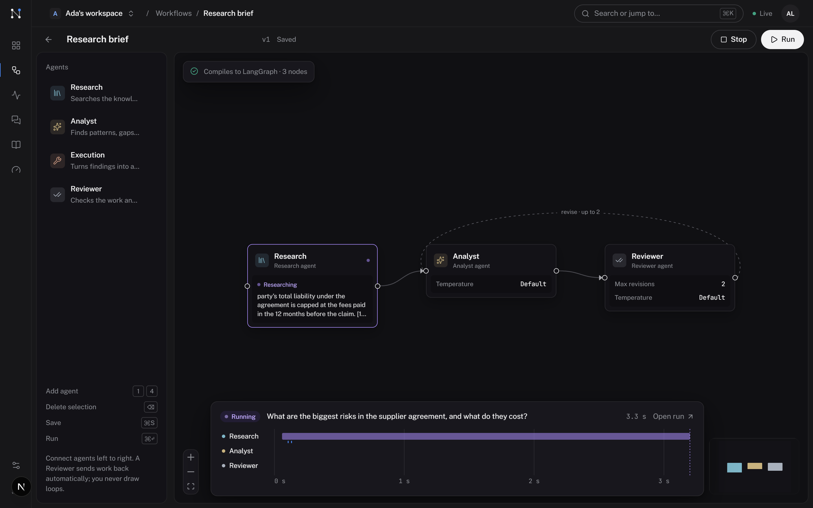
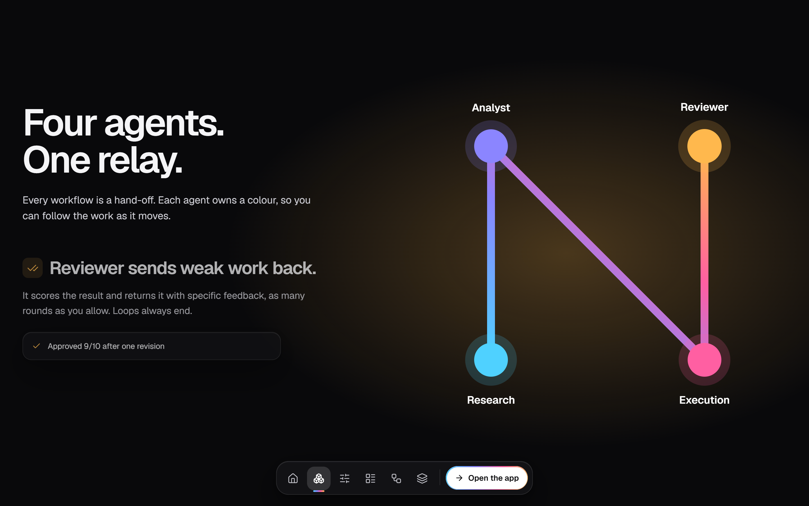
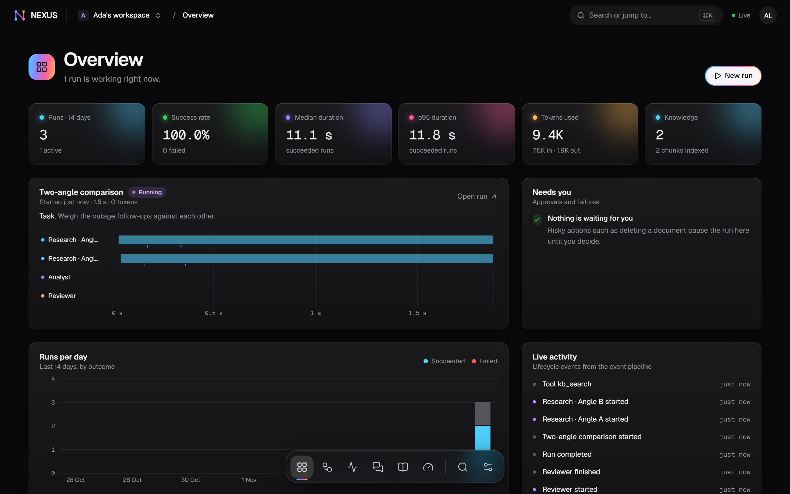
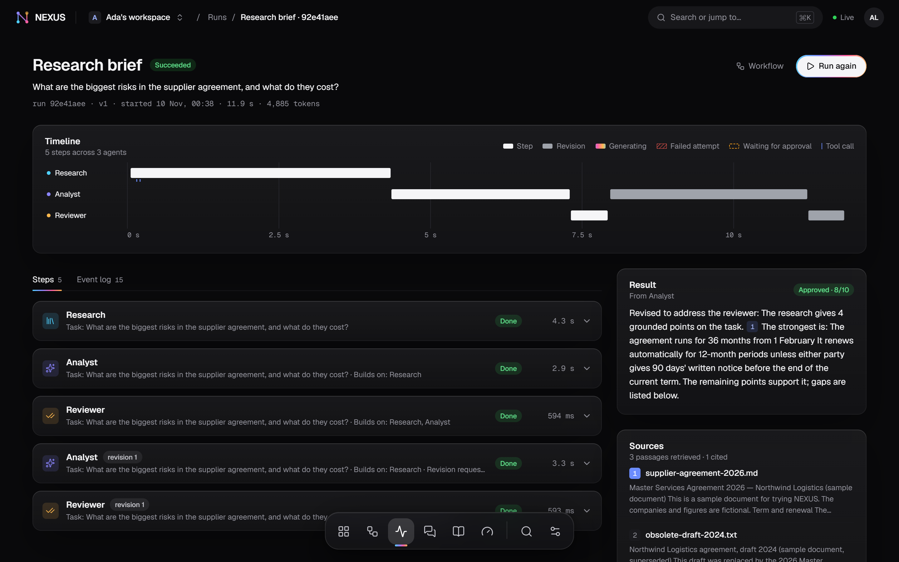
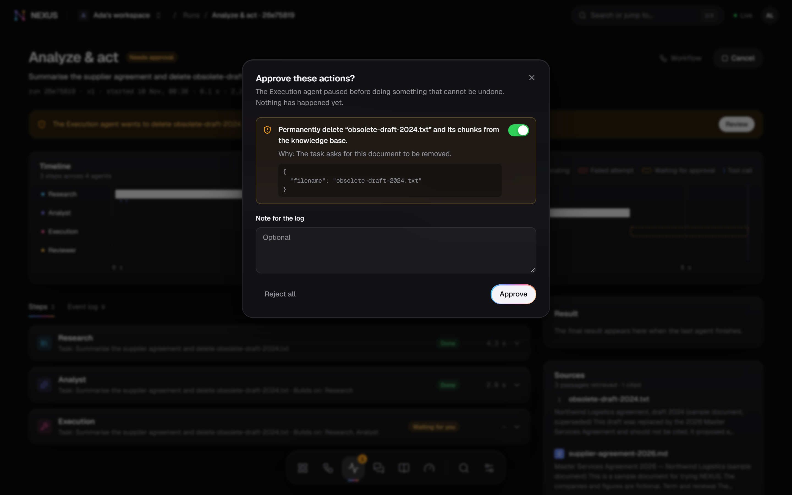
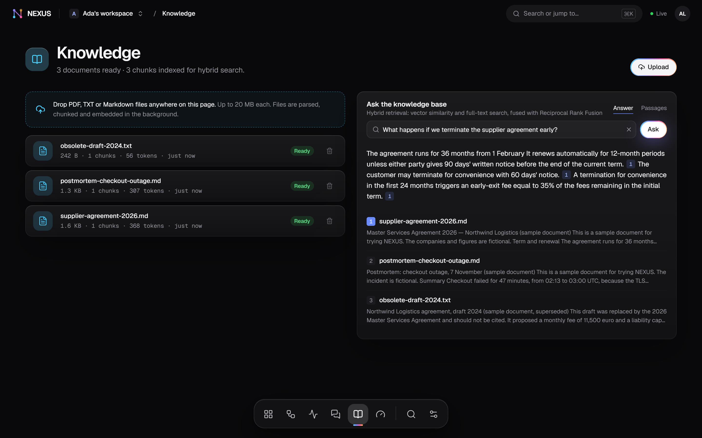
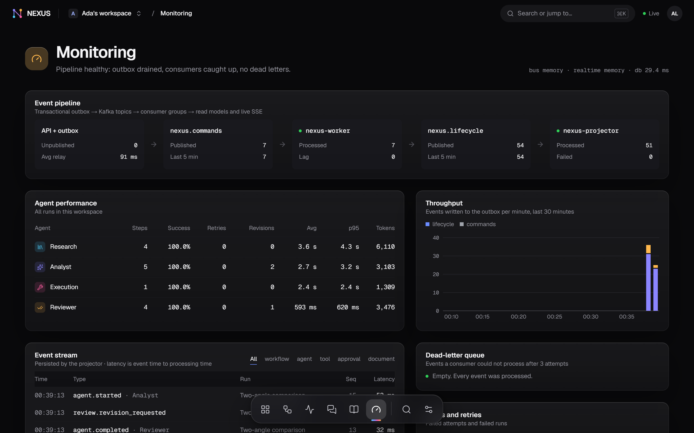
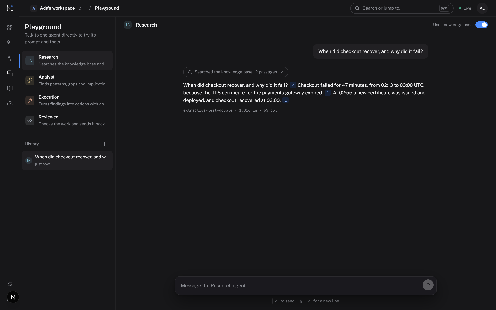
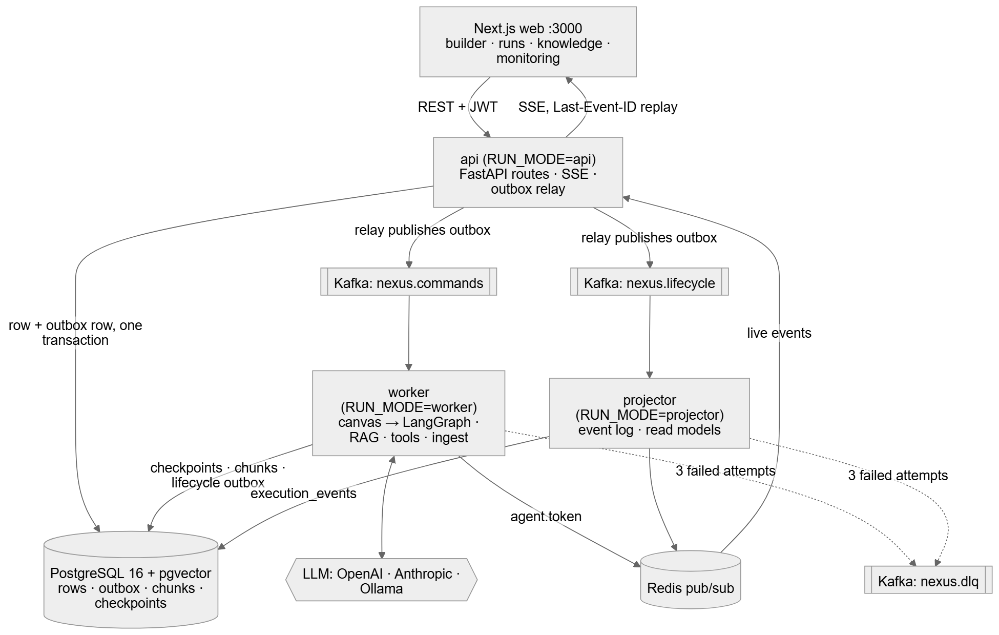

<div align="center">



# NEXUS AI

### Draw a team of AI agents. Watch it work.

NEXUS turns a graph you draw on a canvas into a team of AI agents that research your documents,<br/>
analyse what they find, act on it with your approval, and review their own work, live, step by step.

**[Live demo](https://nexus-three-steel-20.vercel.app)** · [Deploy your own](DEPLOY.md) · [Architecture](docs/architecture.md) · [API docs](https://nexus-three-steel-20.vercel.app/docs)


</div>

---

## Why NEXUS

Most "AI agent" demos are a chat box. NEXUS is a **workflow you can see**:

| | |
|---|---|
| 🧩 **The canvas is the program** | Drag Research, Analyst, Execution and Reviewer agents onto a canvas and connect them. The graph compiles to a LangGraph state machine and is checked first: no orphans, no endless loops. |
| 📚 **Grounded in your documents** | Upload PDF, Markdown or text. Agents search them by meaning *and* exact words (pgvector + full text, fused with Reciprocal Rank Fusion) and cite every passage they use as `[1]`, `[2]`. |
| ✋ **Nothing irreversible without you** | Tools that delete or send are flagged. The run pauses, keeps its state, and continues only after a person approves. |
| 🔁 **Reviewers push back** | A Reviewer agent scores the work and sends it back with specific feedback, up to a revision limit you set. Loops always end. |
| 📡 **Live, and replayable** | Every token, tool call and step streams to the browser over Server-Sent Events and is stored, so any run can be replayed later. |
| 🛟 **Durable** | Each step is checkpointed in Postgres. A run that is interrupted resumes where it was; a failed run retries from its last checkpoint without redoing finished agents. |

---

## A look inside

<table>
  <tr>
    <td width="50%"><br/><b>Builder.</b> The running agent glows in its own colour while its words stream onto the node.</td>
    <td width="50%"><br/><b>Four agents, one relay.</b> Each agent owns a colour, so you can follow the work as it moves.</td>
  </tr>
  <tr>
    <td><br/><b>Overview.</b> Runs, success rate, latency, tokens and a live activity feed.</td>
    <td><br/><b>Run detail.</b> A step timeline, every output with its citations, and full event replay.</td>
  </tr>
  <tr>
    <td><br/><b>Human in the loop.</b> A destructive action waits for you, with the file and the reason.</td>
    <td><br/><b>Knowledge.</b> Upload documents and ask questions; answers cite their passages.</td>
  </tr>
  <tr>
    <td><br/><b>Monitoring.</b> The event pipeline, consumer lag, throughput and dead letters.</td>
    <td><br/><b>Playground.</b> Talk to one agent directly and watch its tool calls.</td>
  </tr>
</table>

<sub>Screenshots come from the end-to-end test harness, which uses a deterministic test model instead of a real LLM so the images are reproducible.</sub>

---

## The design

NEXUS has its own visual language, **Spectrum**:

- **Monochrome, with colour that means something.** The interface is black, white and greys. Each agent owns one hue: Research cyan, Analyst indigo, Execution pink, Reviewer amber. Every gradient you see is those four agents handing work to each other. The logo is the letter N drawn as a run through four nodes in those colours.
- **Glass.** Panels are frosted glass over the team's light. The colour shows through; the text stays crisp.
- **The dock.** Navigation is a small glass dock at the bottom of every page. Icons magnify under the pointer like the macOS Dock, a spectrum bar slides to where you are, and on a phone it becomes a normal tab bar.
- **Motion with GSAP.** A split-text headline, a pinned scroll scene where the logo's N draws itself through the four agents, a sideways pipeline, Flip tab highlights. All of it respects `prefers-reduced-motion`, and the page reads fine without JavaScript.

---

## How a run works

```
 you press Run
   │
   ▼
 FastAPI ──► run row + start command, one database transaction (transactional outbox)
   │
   ▼
 LangGraph ──► Research ──► Analyst ──► Execution ──► Reviewer ─┐
   │              ▲                        │  (waits for your OK) │
   │              └──────── revise, up to N times ◄──────────────┘
   │   every step checkpointed in Postgres
   ▼
 lifecycle events ──► projector ──► run views + event log ──► SSE ──► your browser
 streamed tokens  ──► Redis pub/sub ──────────────────────────► SSE ──► your browser
```

The same code runs in three topologies, chosen by `RUN_MODE`:

| Where | How work is delivered |
|---|---|
| **Vercel** (`serverless`) | No background processes: each request flushes its own outbox, uploads are indexed inside the upload request, and a run executes inside its own live stream. Neon Postgres + Upstash Redis. |
| **One process** (`embedded`) | API, worker and projector in one process with an in-memory bus. The easiest way to develop. |
| **Docker Compose** (`api` / `worker` / `projector`) | Separate containers with Kafka between them, idempotent consumers, retries and a dead-letter queue. |

More detail, delivery guarantees and a code map: **[docs/architecture.md](docs/architecture.md)**.



---

## Quick start

### Run it locally (no Docker)

Needs Python 3.12 with [uv](https://docs.astral.sh/uv/) and Node 20+. Works on Windows, macOS and Linux.

```bash
# 1) Postgres 16 + pgvector, embedded. Prints a DATABASE_URL: put it in backend/.env
cd backend
uv sync
uv run python scripts/dev_db.py

# 2) a model key in backend/.env (see "Choose a model" below), then the API
uv run alembic upgrade head
uv run python scripts/serve.py              # http://127.0.0.1:8000

# 3) the web app (proxies /api/v1 to :8000)
cd ../web
npm install
npx next dev -p 3000                        # http://127.0.0.1:3000
```

Register an account: your workspace starts with three ready workflows. Upload one of the sample documents in [`docs/samples/`](docs/samples) and press Run.

> On Windows, start the API with `scripts/serve.py` rather than the plain `uvicorn` CLI: the async Postgres driver used by the LangGraph checkpointer needs the selector event loop.

### Deploy to Vercel (free tiers)

One Vercel project runs both the Next.js app and the FastAPI API as two services, with Postgres on Neon and Redis on Upstash. Step by step: **[DEPLOY.md](DEPLOY.md)**.

### Docker Compose

```bash
cp .env.example .env          # add a model key
docker compose up --build     # web on :3000, API docs on :8000/docs
```

Starts Postgres (pgvector), Redis, Kafka (KRaft), a migration job, the API, the worker, the projector and the web app.

---

## Choose a model

Set these in `backend/.env` (or as Vercel environment variables). Embeddings run locally on CPU by default, so the knowledge base needs no key at all.

| Provider | Settings |
|---|---|
| **Google Gemini** (free tier works) | `LLM_PROVIDER=google` · `LLM_MODEL=gemini-3.5-flash-lite` · `GOOGLE_API_KEY=…` |
| OpenAI | `LLM_PROVIDER=openai` · `LLM_MODEL=gpt-4.1-mini` · `OPENAI_API_KEY=…` |
| Anthropic | `LLM_PROVIDER=anthropic` · `LLM_MODEL=claude-sonnet-5-5` · `ANTHROPIC_API_KEY=…` |
| Ollama (local, free) | `LLM_PROVIDER=ollama` · `LLM_MODEL=qwen2.5:7b` |

A three-agent run with `gemini-3.5-flash-lite` uses about 5,000 tokens. If no provider is usable, the app says so on Settings and in the Run dialog instead of faking output.

Guards, all configurable in `.env.example`: run timeout, per-step timeout and retries, revision caps, a token budget per run, concurrent runs, upload size, and allowlists for the web and webhook tools.

---

## Tech stack

| Layer | Built with |
|---|---|
| **Web** | Next.js 16 (App Router) · React 19 · TypeScript · Tailwind CSS 4 · React Flow · TanStack Query · GSAP · cmdk |
| **API** | FastAPI · Pydantic v2 · SQLAlchemy 2 (async) · Alembic · structlog · Server-Sent Events |
| **Agents** | LangGraph (state graph, Postgres checkpointer, `interrupt()` approvals) · LangChain `init_chat_model` |
| **Retrieval** | PostgreSQL + pgvector (HNSW) · full-text search · Reciprocal Rank Fusion · fastembed `bge-small-en-v1.5` |
| **Events** | Transactional outbox · Kafka (KRaft) or in-process bus · idempotent consumers · dead-letter queue · Redis pub/sub |
| **Hosting** | Vercel Services · Neon · Upstash, or Docker Compose |

---

## Project layout

```
NEXUS/
├── web/                     Next.js app
│   ├── src/app/             landing page, auth, /app screens
│   ├── src/components/      dock, builder, run views, landing scenes, UI primitives
│   └── e2e/                 Playwright journeys and the screenshot harness
├── backend/                 FastAPI + LangGraph
│   ├── app/agents/          the four agents, prompts, LLM client
│   ├── app/orchestration/   canvas graph → LangGraph compiler and validation
│   ├── app/rag/             parsing, chunking, embeddings, hybrid retrieval
│   ├── app/events/          outbox, buses, consumers, pub/sub
│   ├── app/workers/         run executor, projector, command handling
│   ├── migrations/          Alembic
│   └── tests/               pytest suite
├── docs/                    architecture, samples, screenshots
├── vercel.json              Vercel Services: web + api
├── docker-compose.yml
└── DEPLOY.md
```

---

## Tests

```bash
cd backend && uv run pytest -q        # 34 tests: auth, graph compiler, RAG, runs, events, serverless mode
cd web && npx playwright test         # 12 browser journeys (start scripts/e2e_server.py and the web app first)
```

The backend tests run against a real Postgres with pgvector, real LangGraph and the real outbox and consumers; only the chat model is scripted. The Playwright journeys cover registering, signing in, uploading and searching documents, cited answers, building and saving a workflow, a live multi-agent run, replay, approving a destructive action, the event pipeline and the ⌘K palette. They run against `scripts/e2e_server.py`, the real API with a deterministic test model, so they need no key.

---

## Honest notes

- The live demo runs on free tiers (Vercel Hobby, Neon, Upstash, Gemini free tier). The first request after a quiet period is slow while the serverless function starts, and runs must finish within Vercel Hobby's 5-minute function limit.
- On Vercel a run executes inside its live stream, so it runs while its page is open. If you close the page mid-run, it resumes from its last checkpoint the next time anyone opens it.
- The sample documents in `docs/samples/` and the landing page's example runs are fictional.
- Archival photographs on the landing page are credited in the footer and in `web/public/archive/credits.json`.
