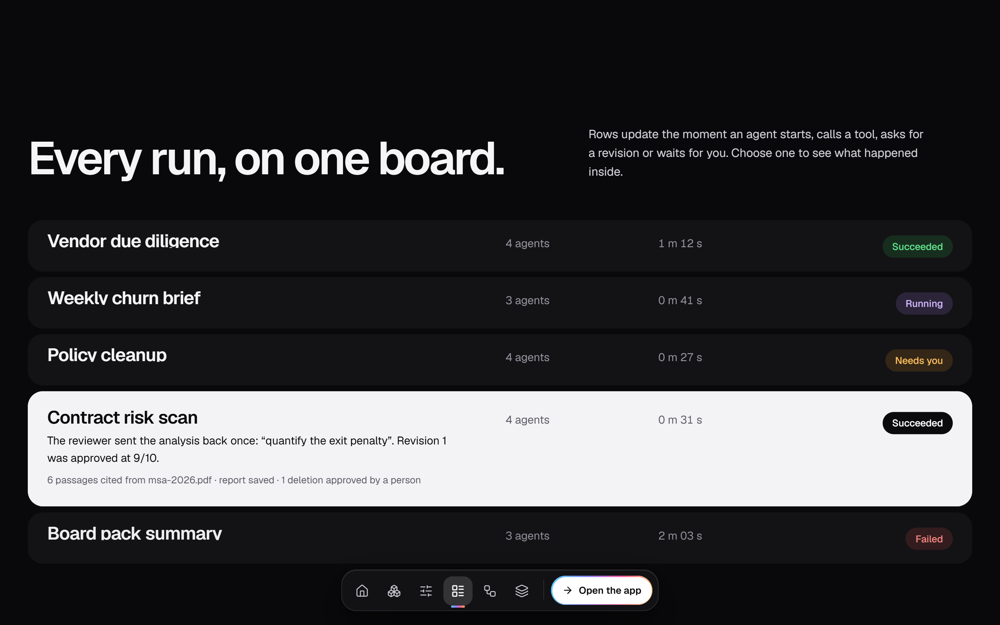
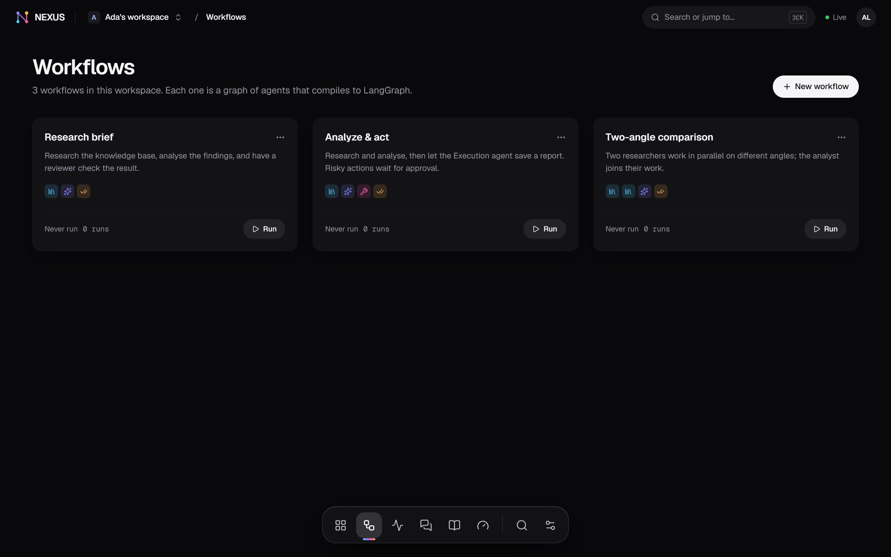
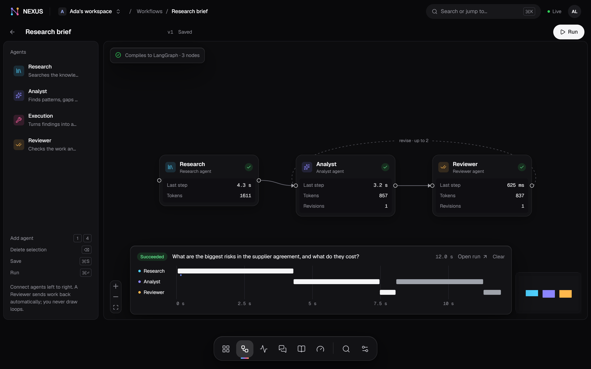
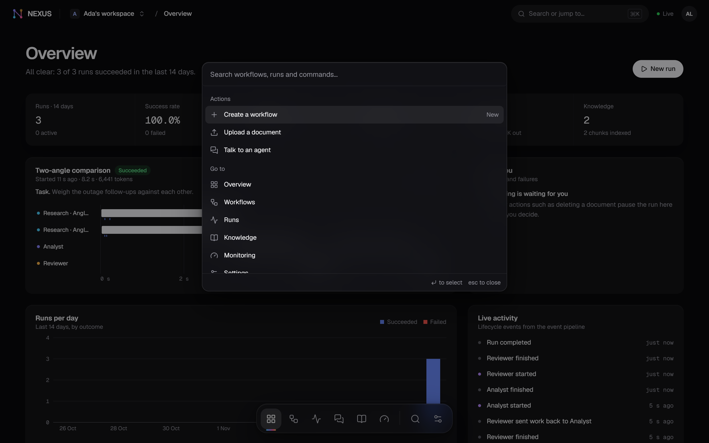
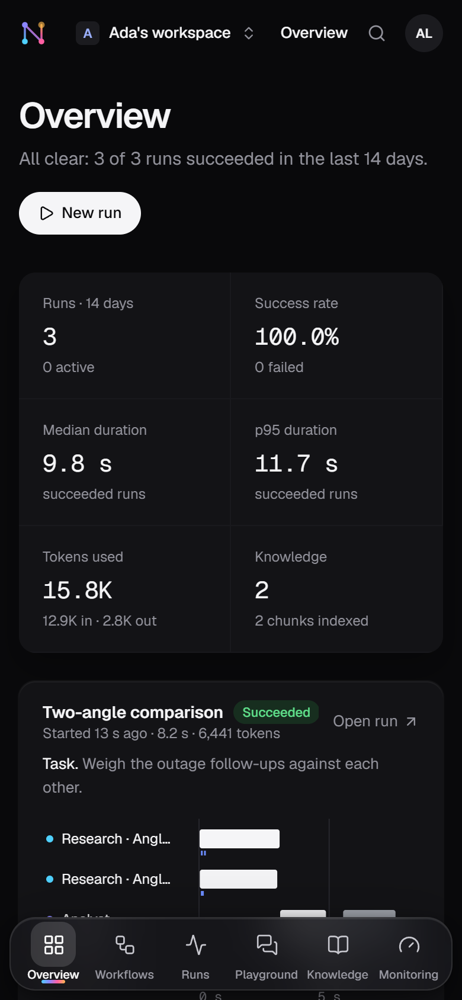

# NEXUS AI

**Draw a team of AI agents, connect your documents, and watch them research, analyse, act and review, live.**

NEXUS turns a graph of agents drawn on a canvas into a durable, observable, event-driven run:

- **The canvas is the program.** Nodes and edges in the React Flow builder compile into a LangGraph `StateGraph`. The graph is validated before it runs: no orphan nodes, END is reachable, and every reviewer loop has a revision cap.
- **Durable.** Runs checkpoint to Postgres. A run survives a worker restart, can be retried from its last checkpoint, and can pause for a person's approval.
- **Event-driven.** The API never runs agents. It writes a command to a transactional outbox, which goes to Kafka; a worker runs the graph, and lifecycle events come back through Kafka. Consumers are idempotent, retry with backoff, and send poison messages to a DLQ.
- **Observable.** Every step, token, tool call and retry is streamed over SSE and persisted, so a run can be replayed later.
- **Grounded.** Agents search the workspace knowledge base (pgvector + full-text, fused with RRF) and cite the chunks they used.


---

## Contents

- [Architecture](#architecture)
- [Quick start (Docker Compose)](#quick-start-docker-compose)
- [Choosing a model provider](#choosing-a-model-provider)
- [Local development without Docker](#local-development-without-docker)
- [Tests](#tests)
- [Screenshots](#screenshots)
- [Design notes](#design-notes)
- [Deploying](#deploying)
- [Project status and honest notes](#project-status-and-honest-notes)

---

## Architecture


One Python package runs as three processes, chosen by `RUN_MODE`:

| Process | Does |
|---|---|
| `api` | REST + SSE, auth, workspaces. Writes domain rows **and** outbox rows in one transaction; the outbox relay publishes them to Kafka. |
| `worker` | Consumes `nexus.commands`: compiles and runs workflows on LangGraph (agents, RAG, tools, `interrupt()` approvals) and ingests documents. |
| `projector` | Consumes `nexus.lifecycle`: appends the numbered event log, updates run/step read models, fans out to Redis pub/sub for SSE. |

`RUN_MODE=embedded` runs all three in one process (handy for development). The full walk-through of a run, the delivery guarantees and a code map are in **[docs/architecture.md](docs/architecture.md)**.

**Stack.** Next.js 16 · TypeScript · Tailwind 4 · React Flow · TanStack Query · motion · cmdk — FastAPI · Pydantic v2 · SQLAlchemy 2 (async) · Alembic · structlog — LangGraph + Postgres checkpointer · LangChain `init_chat_model` — PostgreSQL 16 + pgvector · Kafka (KRaft) via aiokafka · Redis.

---

## Quick start (Docker Compose)

Requirements: Docker Desktop (or Docker Engine + Compose v2), about 4 GB free RAM.

```bash
cp .env.example .env          # then add OPENAI_API_KEY or ANTHROPIC_API_KEY (or use Ollama, below)
docker compose up --build
```

| URL | What |
|---|---|
| http://localhost:3000 | the app (register an account; a workspace with sample workflows is created for you) |
| http://localhost:8000/docs | OpenAPI / Swagger |

Compose starts Postgres (pgvector), Redis, Kafka (KRaft, single broker), a one-shot `migrate` job, then `api`, `worker`, `projector` and `web`. Kafka topics are created by the backend on start.

Generate a real `JWT_SECRET` before exposing it anywhere:

```bash
python -c "import secrets; print(secrets.token_urlsafe(48))"
```

---

## Choosing a model provider

Set these in `.env`. Embeddings run locally by default (`BAAI/bge-small-en-v1.5`, CPU, ~130 MB download on first use), so the knowledge base works without any key.

| Provider | `.env` |
|---|---|
| OpenAI (default) | `LLM_PROVIDER=openai` · `LLM_MODEL=gpt-4.1-mini` · `OPENAI_API_KEY=sk-…` (any OpenAI-compatible endpoint via `OPENAI_BASE_URL`) |
| Anthropic | `LLM_PROVIDER=anthropic` · `LLM_MODEL=claude-sonnet-5-5` · `ANTHROPIC_API_KEY=…` |
| Google Gemini (free tier works) | `LLM_PROVIDER=google` · `LLM_MODEL=gemini-3.5-flash-lite` · `GOOGLE_API_KEY=…` (from Google AI Studio). A three-agent run uses about 5k tokens. |
| Ollama (free, local) | `LLM_PROVIDER=ollama` · `LLM_MODEL=qwen2.5:7b`, then `docker compose --profile ollama up --build` and `docker compose exec ollama ollama pull qwen2.5:7b` |

If no provider is usable, the app says so on Settings and on the run dialog instead of faking output. `GET /api/v1/health/config` reports what is configured.

Guards (all in `.env.example`): run timeout, per-node timeout and retries, revision caps, a per-run token budget, max concurrent runs, upload size, the `http_get` host allowlist and the webhook allowlist for the one destructive tool.

---

## Local development without Docker

Works on Windows, macOS and Linux. Needs Python 3.12 with [uv](https://docs.astral.sh/uv/) and Node 20+.

```bash
# 1) Postgres 16 + pgvector, embedded (pgserver). Prints a DATABASE_URL: put it in backend/.env
cd backend
uv sync
uv run python scripts/dev_db.py

# 2) API + worker + projector in one process, in-memory event bus
#    backend/.env needs DATABASE_URL and a model key (see above)
uv run alembic upgrade head
uv run python scripts/serve.py              # http://127.0.0.1:8000

# 3) web (proxies /api/v1 to :8000)
cd ../web
npm install
npx next dev -p 3000                        # http://127.0.0.1:3000
```

Notes:

- On Windows always start the API with `scripts/serve.py` (or `python -m app.workers` for worker/projector roles), not the plain `uvicorn` CLI: the async psycopg driver used by the LangGraph checkpointer needs the selector event loop.
- If `pip` is your only installer: `pip install uv`, then use `python -m uv …`.
- Without Redis, pub/sub and rate limits fall back to in-process implementations; that is fine for one process.

### With a real Kafka broker, still no Docker

Kafka 3.9 runs on any machine with Java 17+. On Windows the bundled `.bat` scripts fail with "The input line is too long", so call Java directly:

```bash
# from the extracted kafka_2.13-3.9.1 directory; set log.dirs in config/kraft/server.properties first
CP='libs/*'
ID=$(java -cp "$CP" kafka.tools.StorageTool random-uuid)
java -cp "$CP" kafka.tools.StorageTool format -t "$ID" -c config/kraft/server.properties --standalone
java -cp "$CP" kafka.Kafka config/kraft/server.properties      # broker on localhost:9092
```

Then start the backend with `EVENT_BUS=kafka KAFKA_BOOTSTRAP_SERVERS=localhost:9092`. To split the roles, run one process each with `RUN_MODE=api` (`scripts/serve.py`), `RUN_MODE=worker` and `RUN_MODE=projector` (`python -m app.workers`), all pointing at the same database and broker, plus `REDIS_URL` so SSE fan-out crosses processes.

---

## Tests

```bash
cd backend && uv run pytest -q                 # 31 tests: auth, graph compiler, RAG, runs/events (~20 s)
```

The backend tests use `TEST_DATABASE_URL` when set, otherwise the embedded Postgres (a fresh `nexus_test` database each session), and a fake chat model defined in `tests/fakes.py`.

End-to-end (Playwright, 10 user journeys: register, sign in, upload and search documents, cited answers, build and save a workflow, a live multi-agent run, replay, approval of a destructive action, events through the bus, ⌘K palette):

```bash
cd backend && uv run python scripts/e2e_server.py   # real API on :8000 with a deterministic test LLM, fresh nexus_e2e database
cd web && npx next dev -p 3000
cd web && npx playwright test
```

`scripts/e2e_server.py` swaps in one test double, an extractive model that builds answers from the retrieved passages (`tests/extractive_llm.py`), so the journeys are deterministic and need no key. Everything else is production code: Postgres, pgvector, local embeddings, LangGraph, the outbox, the consumers and SSE. Add `EVENT_BUS=kafka KAFKA_BOOTSTRAP_SERVERS=localhost:9092` to run the same journeys over a real broker.

Screenshots in `docs/screenshots/` are made by the same harness: `SHOTS=1 npx playwright test e2e/screenshots.spec.ts`.

---

## Screenshots

Captured with the e2e harness. Agent text in these images comes from the extractive **test double**, not from a real LLM.

| | |
|---|---|
|  Landing: the hero replays a recorded run in the real canvas |  Landing: the run board |
|  Overview: real metrics and a live activity stream |  Workflows |
|  Builder after a finished run |  Run detail with step timeline and replay |
|  Human-in-the-loop approval |  Knowledge base with live ingest status |
|  Monitoring: latency, failures, Kafka lane, DLQ |  Agent playground with tool calls and citations |
|  ⌘K palette |  Overview on a phone |

All 20 are in [`docs/screenshots/`](docs/screenshots/).

---

## Design notes

- **Spectrum.** The interface is monochrome (black, white, greys). Colour has one job: each agent owns a hue (Research cyan, Analyst indigo, Execution pink, Reviewer amber), and every gradient is those four agents handing work on. The logo's four nodes wear the same colours, and a running node, bar or step glows in its agent's colour.
- **The dock.** Navigation is a small glass dock at the bottom of every page. Icons magnify under the pointer (GSAP `quickTo`), a spectrum bar slides to the current place, and on phones it becomes a regular tab bar. On the landing page it follows the section you are reading.
- **Glass on the floating layer** (dock, top bar, menus, ⌘K, sheets, the hero run card), with a `prefers-reduced-transparency` fallback.
- **Motion (GSAP).** SplitText headline, a pinned scroll scene where the logo's N draws itself through the four agents (DrawSVG + ScrollTrigger), a sideways pipeline scroll, Flip tab highlights and batched entrances. Everything is visible without JavaScript and with `prefers-reduced-motion`.
- **Type.** Geist throughout; Geist Mono only for figures, IDs and payloads inside the app.
- **The run is the interface.** The landing hero is a recorded run replayed with the real canvas parts.

---

## Deploying

See **[DEPLOY.md](DEPLOY.md)**: one Vercel project (Next.js + FastAPI as services, agents on Vercel Queues), Postgres on Neon and Redis on Upstash, all on free tiers. Docker Compose remains the self-hosted option.

---

## Project status and honest notes

- **Verified here:** 33 backend tests (including the serverless path, `RUN_MODE=serverless`); 12/12 Playwright tests; `next build`; Playwright on a real Kafka 3.9.1 broker in an earlier round.
- **Real model output:** verified with Google Gemini (`gemini-3.5-flash-lite`, free tier): the Research brief workflow over the sample supplier contract succeeded in 78 s for about 5k tokens, reviewer approved. Screenshots in `docs/screenshots/` still come from the deterministic test model.
- **Not verified here:** a Vercel deployment and `docker compose up` (no Docker on the development machine). Both are written and documented.
- **Sample content to replace before launch:** the fictional documents in `docs/samples/`, the landing board rows and hero traces (`web/src/components/landing/traces.ts`, `BOARD` in `sections.tsx`), and the run fragment on the auth pages.
- Archival photographs on the landing page are credited in `web/public/archive/credits.json` and in the footer.
