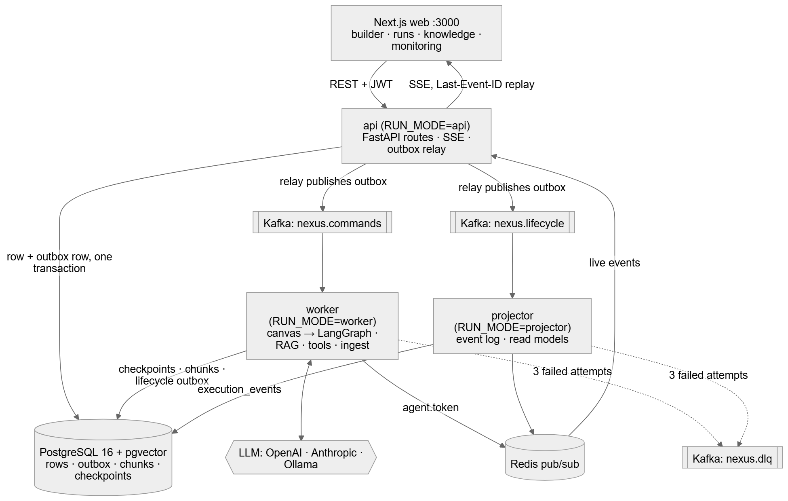
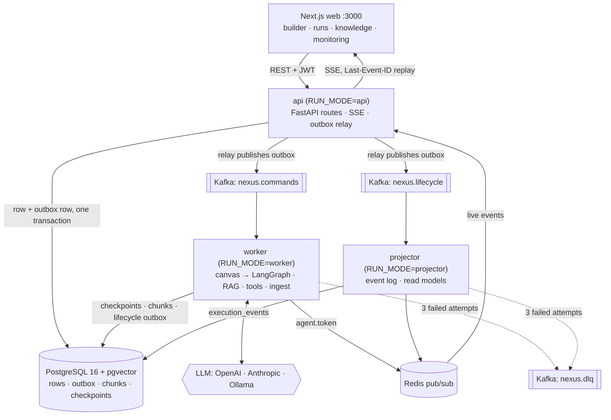

# NEXUS AI — architecture

NEXUS turns a graph of AI agents drawn on a canvas into a durable, observable, event-driven run.
One Python package runs as three processes (`api`, `worker`, `projector`, chosen by `RUN_MODE`);
the web app is a separate Next.js service.



<details><summary>Mermaid source (also in <code>architecture.mmd</code>)</summary>



</details>

## The path of one run

1. **Request.** `POST /api/v1/workflows/{id}/runs` writes the `workflow_runs` row and a `workflow.run.requested` outbox row in the same transaction. If the API dies right after commit, the relay still publishes it; if the transaction rolls back, nothing is published.
2. **Relay.** The outbox relay claims unpublished rows with `FOR UPDATE SKIP LOCKED` (several API replicas are safe), publishes them to Kafka keyed by `run_id` (ordering per run) and marks them published.
3. **Execute.** The worker consumes `nexus.commands`, compiles the stored canvas JSON into a LangGraph `StateGraph` (validated: no orphans, reachable END, a revision cap on every cycle) and runs it with the Postgres checkpointer. Guards: per-node timeout and retries, run timeout, token budget, recursion limit.
4. **Approve.** A destructive tool calls `interrupt()`. The run parks as `awaiting_approval`; `POST /api/v1/approvals/{id}/decision` resumes it from the checkpoint.
5. **Project.** Lifecycle events go worker → outbox → `nexus.lifecycle` → projector, which appends `execution_events` (numbered `seq`), updates the run and step rows, and publishes to Redis.
6. **Watch.** The SSE endpoint replays persisted events after `Last-Event-ID`, then streams live ones from Redis. Token deltas skip Kafka and go straight to pub/sub: they are high volume and not worth persisting.

## Delivery guarantees

| Concern | Mechanism |
|---|---|
| No lost events between DB and bus | Transactional outbox + relay |
| Duplicates (at-least-once delivery) | `processed_events(consumer, event_id)` idempotency ledger |
| Poison messages | 3 attempts with exponential backoff → `nexus.dlq`; Monitoring lists and replays them |
| Ordering | Message key = `run_id`; one partition per key |
| Worker crash mid-run | LangGraph Postgres checkpointer; the recovery task re-queues orphaned runs; "retry from checkpoint" in the UI |
| Back-pressure | `MAX_CONCURRENT_RUNS` semaphore in the worker; consumer lag shown in Monitoring |

## Event bus implementations

`app/events/bus.py` has two implementations behind one interface:

* **`KafkaBus`** (aiokafka): Docker Compose and production. Topics are created on start (6 partitions); consumers commit offsets only after the handler returns.
* **`MemoryBus`**: same consumer-group semantics in-process. Used by the unit tests and by the single-process local mode (`RUN_MODE=embedded`, `EVENT_BUS=memory`).

Both were exercised end to end: the Playwright suite passes 10/10 on `EVENT_BUS=memory` and on a real Kafka 3.9.1 broker (`EVENT_BUS=kafka`), with all consumer groups at zero lag afterwards.

## Code map

```
backend/app/
  api/v1/         REST + SSE routes
  core/           config, security (JWT), logging, errors, dependencies, rate limits
  database/       engine and sessions
  models/         SQLAlchemy models          schemas/  Pydantic I/O
  services/       workflow, run, document business logic
  orchestration/  spec.py (canvas schema + validation), compiler.py (→ StateGraph)
  agents/         research, analyst, execution, reviewer; LLM layer (init_chat_model)
  tools/          registry with allowlist + destructive flag (kb_search, http_get, write_report, send_webhook)
  rag/            parsing, chunking, embeddings, hybrid retrieval (vector + full text, RRF)
  events/         envelope, outbox + relay, bus (Kafka / memory), consumer base (idempotency, retry, DLQ), pub/sub
  workers/        runtime (role by RUN_MODE), command consumer, run executor, projector, checkpointer
web/src/
  app/            routes: landing, login, register, app/* (overview, workflows, builder, runs, knowledge, playground, monitoring, settings)
  components/     shell, builder canvas, run views, landing sections
  lib/            API client, session, SSE + run hooks
```
